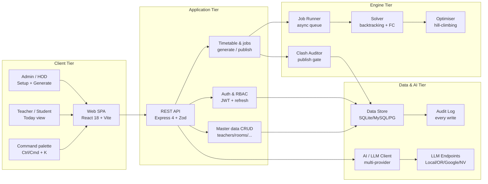
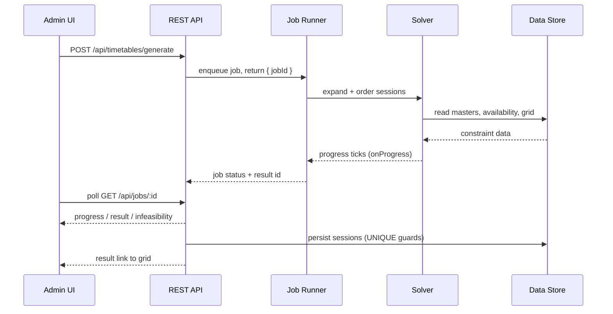
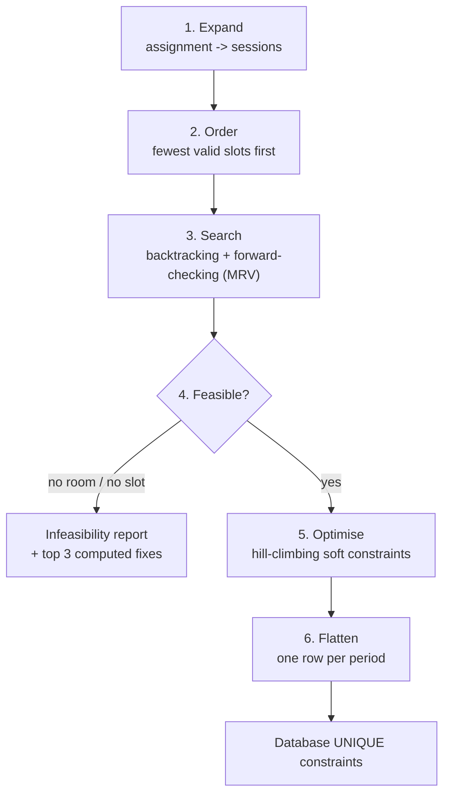
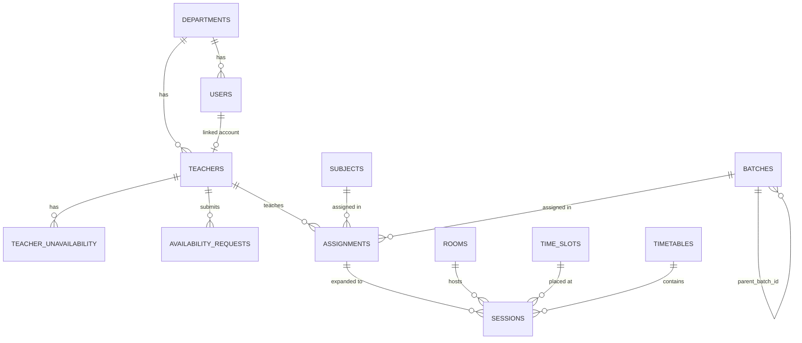
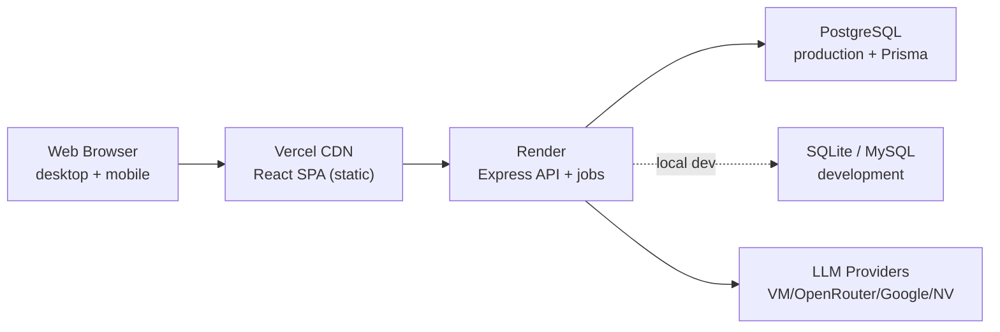

# SlotSync — System Architecture

**Clash-Free College Timetable Generator**
MERN stack · Constraint-satisfaction scheduling engine · Multi-provider AI assistant

- **Version:** 1.0
- **Status:** Approved for implementation
- **Source:** SlotSync repository (README + PRD)

---

## Table of contents

1. [Overview](#1-overview)
2. [High-Level Architecture](#2-high-level-architecture)
3. [Layered Architecture](#3-layered-architecture)
4. [Component Catalog](#4-component-catalog)
5. [Runtime Flows](#5-runtime-flows)
6. [Scheduling Engine](#6-scheduling-engine)
7. [Data Architecture](#7-data-architecture)
8. [AI Assistant Layer](#8-ai-assistant-layer)
9. [Deployment Topology](#9-deployment-topology)
10. [Security, Reliability & NFRs](#10-security-reliability--nfrs)
11. [Technology Stack](#11-technology-stack)

---

## 1. Overview

SlotSync replaces hand-built spreadsheet timetables with a one-click generator that produces a full weekly timetable with **zero hard conflicts**, or a plain-language report explaining exactly what blocks a solution. Administrators build the reference data once, generate a timetable, then review, edit, publish and share it. Teachers and students get a clean, mobile-first view of the same published data.

### 1.1 Architectural principles

- **Correctness first.** Hard constraints (no double-booked teacher, room or batch) are enforced by the solver and re-enforced by database-level `UNIQUE` constraints, so a clash is impossible even if a code path has a bug.
- **Separate frontend and backend.** A stateless Express REST API and a React SPA are deployed independently; the API is the only holder of business rules and credentials.
- **Async by design.** Long-running generation is offloaded to background jobs with progress polling, so the API never blocks.
- **Server-enforced authorisation.** Role and department scoping are checked on every request; hiding a UI control is never the only protection.
- **AI as an assistant, never the scheduler.** The solver and database own correctness; AI only reads, translates, explains and summarises, and never writes timetable data.
- **One source of truth per role.** Every role reads the same teachers, rooms and availability lists, so no view disagrees across roles.

---

## 2. High-Level Architecture

The system is a classic three-tier web application with a dedicated scheduling engine and an optional multi-provider AI layer. Clients talk only to the REST API; the API owns the data store, the job runner and the solver.

**Reads are unified:** every authenticated role receives the same full teacher, room and availability lists. **Writes stay role-scoped** (Admin globally, HOD within their department). Published timetables are exposed anonymously through read-only endpoints; drafts stay private.

---

## 3. Layered Architecture

| Layer | Responsibility |
| --- | --- |
| **Presentation** | React 18 SPA built with Vite. React Router for routes, TanStack Query for server state and caching, Zustand for auth/theme/view state, Framer Motion for restrained animation, dnd-kit-style grid interaction. Mobile-first; graceful loading, empty and error states; global error boundary. |
| **API / Application** | Express 4 REST API. JWT authentication (15-min access token + 7-day rotating refresh cookie), Zod validation middleware, role and department guards, CORS, structured logging and a central error handler returning `{ error, fix }` payloads. |
| **Domain / Service** | Route handlers orchestrate domain services: auth, users, availability, master data, time grid, timetables, jobs, exports, audit and AI. All writes are transactional and audited. |
| **Engine** | The scheduling engine expands assignments into sessions, orders them by difficulty, runs backtracking search with forward-checking, optimises soft constraints with hill-climbing, and flattens the result to one row per period. A job runner reports progress asynchronously. |
| **Data** | A generic synchronous record store backed by `node:sqlite` or MySQL for local development, and a PostgreSQL schema with anti-clash `UNIQUE` constraints for production. The store API is identical across dialects, so route code does not change when moving to Prisma/Postgres. |
| **AI** | A multi-provider LLM client speaking the OpenAI-compatible `/chat/completions` protocol, plus a deterministic on-device engine that works with no keys at all. Strictly read-only with respect to timetable data. |

---

## 4. Component Catalog

| Component | Responsibility | Key tech |
| --- | --- | --- |
| Frontend SPA | Setup wizard, dashboard, generate flow, drag-and-drop grid, Today view, Bulba chat, command palette. | React, Vite, Router, TanStack Query, Zustand, Framer Motion |
| API server | Mounts routes, validates input, enforces auth/RBAC, returns unified response envelopes. | Node.js, Express, Zod, morgan, cors |
| Auth service | Login, refresh-token rotation, logout, lockout, password hashing. | jsonwebtoken, bcryptjs, cookie-parser |
| Master data service | CRUD for teachers, rooms, subjects, batches, assignments, departments. | Express routes + record store |
| Availability service | Teacher unavailability, requests, HOD approval, read-unification across roles. | Express routes + Zod |
| Time grid service | Working days, periods per day, period timings, break slots (reserves lunch). | Express routes |
| Job runner | Queues generation jobs, tracks status/progress, exposes terminal result or report. | In-process async worker |
| Solver | Backtracking + forward-checking CSP placement; infeasibility detection. | Pure JS |
| Optimiser | Hill-climbing swaps for soft constraints without breaking hard rules. | Pure JS |
| Clash auditor | Re-checks teacher/room/batch bookings before publish; failure blocks publish. | Pure JS over store |
| Export service | CSV and iCal (`.ics`) generation; PDF returns `501` by design. | Node streams |
| AI service | Chat, rules parsing, explanations, Q&A; multi-provider with on-device fallback. | `llm.js` + `ai.js` |
| Audit log | Records create/update/delete/move/publish/snapshot/generate/seed/login with who and when. | Record store |
| Data store | Generic sync record API over SQLite/MySQL; PostgreSQL schema for production. | node:sqlite, mysql2, Prisma |

---

## 5. Runtime Flows

### 5.1 Timetable generation

### 5.2 Authentication and session lifecycle

- **Login.** `POST /api/auth/login` verifies the bcrypt hash, returns a 15-minute access token and sets a 7-day rotating refresh token in an httpOnly cookie.
- **Refresh.** `POST /api/auth/refresh` rotates the refresh token and issues a new access token; logout revokes it immediately.
- **Lockout.** Five failed logins within 15 minutes locks the account for 15 minutes and notifies an Admin or HOD.
- **Authorise.** Each request re-checks role and department scope server-side; account deletion is soft (deactivate when sessions exist).

### 5.3 Manual session editing

- Drag-and-drop or click-to-move calls `PATCH /api/sessions/:id` with `slot_id` or `day`+`period` (and optionally `room_id`).
- Every move is validated server-side; blocked moves return a plain-language reason plus suggested valid slots.
- Locked sessions cannot move until unlocked; the same `UNIQUE` constraints guard the write at the database level.

---

## 6. Scheduling Engine

`backend/src/solver.js` implements constraint-satisfaction timetabling. It is a pure-JS module so it can run inside the API process or be lifted into a worker thread / queue without changing its interface.

1. **Expand** — turn every assignment into the individual sessions that must be placed (weekly sessions × periods per session).
2. **Order** — sort by difficulty: fewest valid start slots first, with labs/long sessions, tight availability and big batches weighted up.
3. **Search** — backtracking with forward-checking (MRV): place the most-constrained session first; placing removes that slot/teacher/room from competitors.
4. **Detect** — early infeasibility detection: any session with no valid room or no valid start slot fails fast with a report and the top 3 computed fixes.
5. **Optimise** — hill-climbing swaps improve soft constraints (spread subjects, reduce gaps, respect caps) without ever breaking a hard rule.
6. **Flatten** — emit one row per period, ready for the database's anti-clash `UNIQUE` constraints.

**Configuration:** `timeLimitMs` (default 25s), `maxNodes` (default 60,000) and an `onProgress` callback wired to the job record. Hard constraints are guaranteed: a teacher, room and batch each hold at most one session per slot; availability, room capacity/type and break avoidance are respected; multi-period blocks stay consecutive and never cross a break; and every required weekly session is placed or reported.

---

## 7. Data Architecture

The development store (SQLite/MySQL) mirrors the production PostgreSQL tables via a generic synchronous record API, so migration to Prisma/Postgres requires no route changes.

### 7.1 Entity relationships

### 7.2 Anti-clash constraints (on `sessions`)

Enforced in the PostgreSQL schema and re-audited in the application before publish:

- `UNIQUE (timetable_id, slot_id, teacher_id)`
- `UNIQUE (timetable_id, slot_id, room_id)`
- `UNIQUE (timetable_id, slot_id, batch_id)`

Multi-period sessions are stored as one row per period, so these constraints cover them too.

### 7.3 Core collections

`departments`, `users`, `teachers`, `teacher_unavailability`, `availability_requests`, `rooms`, `subjects`, `batches` (with `parent_batch_id` for split labs), `assignments`, `time_slots`, `timetables`, `sessions`, `jobs`, `audit_log`, `refresh_tokens`.

---

## 8. AI Assistant Layer

Bulba is a multilingual, read-only assistant. AI never writes timetable data: the solver and database constraints own correctness, and AI only reads, translates, explains and summarises. It works with no keys at all via an on-device engine and upgrades to a hosted multilingual chatbot when a provider key is added.

### 8.1 Provider fallback chain

Default order is `local → openrouter → google → nvidia`, overridable with `AI_FALLBACK_ORDER`. Only configured providers are in the chain.

| Order | Provider | Config |
| --- | --- | --- |
| 1 | Local VM (primary) | `LOCAL_AI_BASE_URL` / `LOCAL_AI_MODEL` (no key) |
| 2 | OpenRouter | `OPENROUTER_API_KEY` |
| 3 | Google AI Studio | `GEMINI_API_KEY` |
| 4 | NVIDIA NIM | `NVIDIA_API_KEY` |

Any error, timeout or rate-limit rolls to the next provider; each attempt has a 30s timeout. If every provider fails, the endpoint falls back to the on-device engine and marks the reply `fallback: true`. Responses report `provider`, `tried` and `fellBack`.

### 8.2 Capabilities and endpoints

| ID | Feature | Endpoint | Status |
| --- | --- | --- | --- |
| A0 | Multilingual chat (Bulba) with on-device fallback | `POST /api/ai/chat` | Live |
| A1 | Plain-English rules → structured availability suggestion | `POST /api/ai/rules/parse` | Live |
| A2 | Infeasibility explainer (plain words + top fixes) | `POST /api/ai/explain` | Live |
| A3 | Smart CSV import column mapping and typo flags | `POST /api/ai/import/map-columns` | Planned |
| A4 | Ask SlotSync natural-language Q&A over the timetable | `POST /api/ai/ask` | Live |
| A5 | Change notes summary when a timetable changes | `POST /api/ai/explain` | Live |
| — | Provider + health for the assistant badge | `GET /api/ai/status` | Live |

### 8.3 Guardrails

- AI never writes timetable data; every AI output is a suggestion the admin confirms.
- Structured JSON output validated by Zod, with one retry then a friendly fallback to the manual form.
- Only a compact data digest (codes, names, counts) is sent; no student PII.
- Keys are never logged or returned to the client; a 30s timeout protects the UI.

---

## 9. Deployment Topology

The API and SPA are independent sites; the LLM endpoints are external or self-hosted.

- **API (Render).** Set `FRONTEND_URL` to the Vercel origin (comma-separated for several; `*.vercel.app` previews allowed), a long random `JWT_SECRET`, and `NODE_ENV=production`. CORS reflects the allowed origin; the refresh cookie is `SameSite=None; Secure`.
- **SPA (Vercel).** `frontend/.env.production` points the build at the API host; `vercel.json` rewrites all paths to `index.html` for client-side routing.
- **Database.** Local dev uses `node:sqlite` or MySQL; production uses PostgreSQL via Prisma (`npx prisma migrate deploy`). TiDB Cloud is supported as a managed MySQL-compatible option.
- **AI endpoints.** A self-hosted OpenAI-compatible server is primary; hosted keys are optional fallbacks. Keys live only in backend environment variables.

---

## 10. Security, Reliability & NFRs

### 10.1 Security

- Passwords hashed with bcrypt; hashes never returned to clients.
- Short-lived 15-minute access token plus a 7-day rotating refresh token in an httpOnly cookie.
- Role and department checks on every request (Admin global, HOD own department, Teacher/Student scoped).
- Login rate limiting: 5 failed attempts in 15 minutes locks the account for 15 minutes.
- Teachers owning sessions are deactivated, never hard-deleted; users cannot delete themselves or manage admins.
- Every sensitive action is written to the audit log (who, what, when, previous value).

### 10.2 Reliability and integrity

- Database-level `UNIQUE` constraints make clashes impossible regardless of code path.
- An automated clash audit re-checks every teacher, room and batch per slot before publish; a failure blocks publishing.
- Multi-step changes run in one transaction, so a failure leaves the timetable unchanged.
- Structured logs and error tracking on the API and solver; nightly database backups.

### 10.3 Non-functional targets

| Area | Target |
| --- | --- |
| Scale (v1) | Up to 60 teachers, 40 rooms, 40 batches, 6 days × 8 periods |
| Generation time | < 30s typical, < 2 min worst case, async with progress |
| UI performance | Grid interactions at 60 fps; initial load < 2.5s on 4G |
| Reliability | 99.5% uptime during term; nightly DB backups |
| Correctness | 0 hard conflicts in any published timetable (verified by audit) |
| Browser support | Latest Chrome, Edge, Safari, Firefox; iOS Safari and Android Chrome |

---

## 11. Technology Stack

| Layer | Technology |
| --- | --- |
| Frontend | React 18, Vite 5, React Router 6, TanStack Query 5, Zustand 4, Framer Motion 11 |
| Backend | Node.js, Express 4, Zod, jsonwebtoken, bcryptjs, cookie-parser, morgan, cors |
| Database (dev) | `node:sqlite` (default) or MySQL (`mysql2`) via a generic records store |
| Database (prod) | PostgreSQL via `backend/prisma/schema.prisma` |
| Solver | Pure-JS backtracking with forward-checking + hill-climbing (`backend/src/solver.js`) |
| AI | Multi-provider LLM client + deterministic on-device engine (`backend/src/llm.js`, `ai.js`) |
